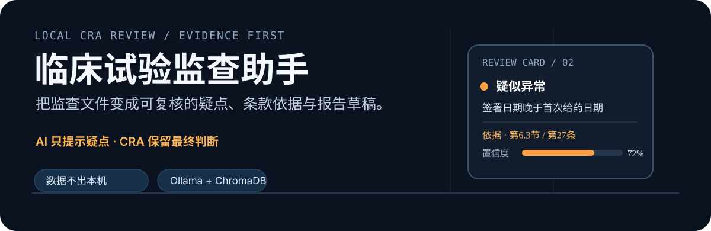
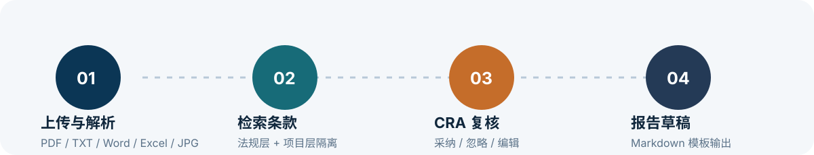
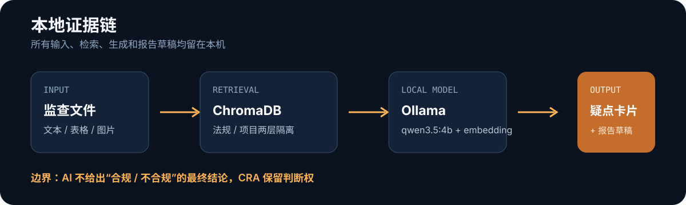

<p align="center">
  
</p>

<p align="center">
  <a href="https://github.com/cqyu2026/cra-monitor-demo"></a>
  
  
  
</p>

# 临床试验监查助手

面向 CRA（临床监查员）的本地监查辅助演示。上传监查文件后，系统从法规层和项目层知识库检索相关条款，由本地模型标记“疑似异常”、给出依据和置信度，再交给 CRA 采纳、忽略或编辑，最后生成 Markdown 报告草稿。

AI 只提供复核线索，不输出“合规 / 不合规”的最终结论。文件、知识库、向量库、模型调用和报告草稿都留在本机。

<p align="center">
  
</p>

## 这套 Demo 解决什么问题

监查文件里的日期、签名和给药记录，往往需要同时对照项目方案与法规。这个项目把这条路径收拢成一个本地闭环：

- 上传 PDF、TXT、Word、Excel 或 JPG，并在页面中核对解析文本。
- 以法规层与项目层两层 metadata 隔离知识库，避免不同项目的条款串库。
- 给每条 AI 提示附上依据条款、原文摘录、置信度和文件来源位置。
- 由 CRA 决定采纳、忽略和修改哪些发现，再套用可编辑 Markdown 模板。

## 本地证据链

<p align="center">
  
</p>

实现边界很明确：不连接外部 EDC 或 CTMS，不调用云端 API，不把 AI 输出当作最终合规判断。

## 快速启动

项目要求 Python 3.13，并使用项目自带的 `.venv`。首次使用：

```bash
cd /Users/yu/Documents/cra-monitor-demo
.venv/bin/python -m pip check
ollama serve
.venv/bin/python ingest.py
.venv/bin/streamlit run app.py --server.headless true
```

打开 <http://localhost:8501>。

启动 Ollama 前，确认本机已有模型：

```bash
ollama pull qwen3.5:4b
ollama pull nomic-embed-text
```

应用只访问 `http://localhost:11434`。`.streamlit/config.toml` 已关闭 Streamlit 使用统计，ChromaDB 匿名遥测也已关闭。

> `ingest.py` 会清空并重建本地 ChromaDB 集合。它适合首次建库或明确需要重建时使用，不是无副作用的启动命令。

## 演示路径

1. 在“智能预审”上传 `sample_data/模拟知情同意书.txt`，查看前 500 字解析预览。
2. 点击“开始预审”，查看疑似异常、法规或项目条款、置信度和来源位置。
3. 切到“人机协同清单”，手动输入发现项并匹配条款，或编辑预审清单。
4. 将需要纳入报告的条目标记为“采纳”。
5. 进入“报告生成”，勾选条目并下载 Markdown 草稿。

演示新项目开工时，可在侧边栏输入项目名称，上传项目方案并点击“入库”。同名来源会先移除旧向量，再写入新版本；项目层检索只允许命中当前 `project_id`。

## 目录

| 文件 | 作用 |
| --- | --- |
| `app.py` | Streamlit 三标签页界面、上传、清单和报告下载 |
| `audit.py` | 关键事实提取、两层过滤检索和疑点生成 |
| `ingest.py` | 文档切块、向量化、ChromaDB 持久化和方案升版删除 |
| `parse_document.py` / `ocr.swift` | PDF/TXT/Word/Excel/JPG 的本地文字提取 |
| `knowledge/` | 真实法规与指南来源，作为 RAG 知识库 |
| `sample_data/` | 本地演示输入，默认不提交 Git |
| `project_docs/` | 运行时上传的项目文件，实际文件默认不提交 Git |
| `report_template.md` | 报告输出格式，可直接编辑 |
| `assets/readme/` | GitHub 首页的项目专属 SVG 素材 |

需求边界见 [`cra-monitor_SCOPE.md`](cra-monitor_SCOPE.md)，当前交接状态见 [`PROJECT_CONTEXT.md`](PROJECT_CONTEXT.md)。

## 文件格式说明

- PDF：使用 `pypdf` 提取文本。
- TXT：按 UTF-8 文本读取。
- DOC / DOCX：使用 macOS `textutil`。
- XLS / XLSX：使用本机 LibreOffice 转换为 HTML，再提取文本。
- JPG / JPEG：使用 macOS Vision OCR。

解析结果会在界面中预览。对于表格和图片，请在启动预审前核对日期、签名和关键字段是否被正确识别。

## 重要边界

- 每条 AI 提示都必须带置信度和依据条款。
- AI 只标记疑点，最终判断由 CRA 完成。
- 不连接外部 EDC / CTMS。
- 不调用云端 API。
- 报告生成是模板文本填充，不再调用模型。

这是一个本地演示项目，不替代 CRA 的专业判断、现场核查或正式质量管理流程。
